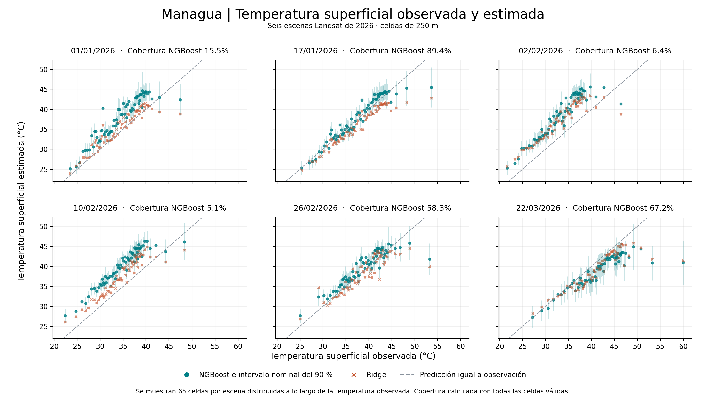
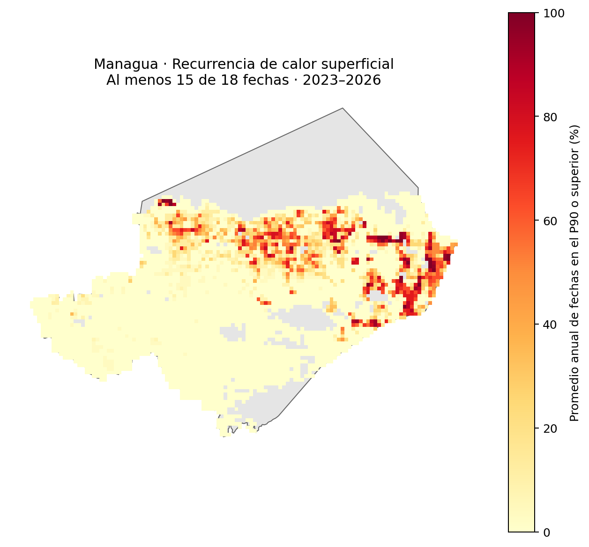

# Surface temperature in Managua

A Python study of land surface temperature at Landsat overpass time. The target is the median surface temperature within each 250 m cell, in °C.

## Retrospective evaluation

The regression models were trained on 12 Landsat scenes from 2023–2025 and evaluated on six scenes from 2026. The table averages each metric across scenes.

| Model | MAE (°C) |
|---|---:|
| Cell historical mean | 3.491 |
| Ridge | **2.245** |
| NGBoost | 3.243 |
| Ridge + ERA5-Land air temperature | 2.280 |
| Ridge + ERA5-Land solar radiation | 2.347 |

Ridge uses prior cell temperature history, day of year, tree cover, built-up fraction, and elevation. Training rows use only earlier dates for their temperature history. NGBoost's nominal 90% prediction intervals covered 40.3% of observations on average across scenes.



## Spatial recurrence

The map shows the average of annual fractions of available scenes in which each cell reached the scene-specific 90th percentile. Cells required valid observations in at least 15 of 18 scenes and representation in all four years. The eligible cells represent approximately 89.9% of municipal land area.



## Reproduce

Run these commands from the repository root in a Python environment:

```bash
python -m pip install -r requirements.txt
python scripts/evaluar_2026.py
python scripts/reentrenar.py
```

The evaluation script uses the included processed panel. The retraining script writes the final Ridge pipeline and cell histories. Run the first cell of `notebooks/02_prueba_modelo_guardado.ipynb` with the working directory set to the repository root for a clean-session prediction demonstration. Retraining before loading the bundled model avoids cross-version joblib compatibility issues. The original research notebook records acquisition and exploratory steps. The committed panel is gzip-compressed; the standalone scripts read it directly. To use the original notebook cells that expect an uncompressed CSV, extract the panel to `data/predictores/managua_panel_con_predictores.csv` first. Some acquisition steps require an authorized Google Earth Engine project.

## Data sources and scope

- [USGS Landsat Collection 2 surface temperature](https://www.usgs.gov/landsat-missions/landsat-collection-2-surface-temperature)
- [ESA WorldCover 2021](https://developers.google.com/earth-engine/datasets/catalog/ESA_WorldCover_v200)
- [Copernicus DEM GLO-30](https://developers.google.com/earth-engine/datasets/catalog/COPERNICUS_DEM_GLO30_2024_1)
- [ERA5-Land hourly](https://developers.google.com/earth-engine/datasets/catalog/ECMWF_ERA5_LAND_HOURLY)
- [geoBoundaries](https://www.geoboundaries.org/)

The final Ridge model was retrained on all 18 scenes from 2023–2026. The 2027 maps are demonstrations. Prospective evaluation requires predictions archived before confirmed Landsat acquisitions and paired observations on the same cells and dates. The multi-date band is exploratory and has no nominal coverage.


## Experimental temporal validation

Run `python scripts/evaluar_temporal.py` to evaluate 2025 and 2026 in expanding windows. Each test year uses only preceding years for fitting and its cell histories are frozen at the split. The two-component model predicts one thermal level per date and a spatial deviation per cell. Test observations enter only the scoring. Scene means use the cells with valid observations on each date, so differences in footprint can affect this diagnostic. The CSV records the signed error of the scene level and the MAE of the spatial deviation. Without a weather CSV the scene component uses day of year. Supply `--weather features.csv` with one numeric row per date keyed by `fecha`. Use only features available at the intended prediction time.

Run `python -m unittest discover -s scripts` to check the history against look-ahead leakage.

### Historical catalog

Install `earthengine-api` in addition to the model requirements and authenticate Earth Engine. Supply the same municipal polygon used in the notebook as a WGS84 GeoJSON geometry or Feature. The notebook's municipal-boundary cell can write it using `managua.to_file("managua.geojson", driver="GeoJSON")`. If that exports a FeatureCollection, pass its first feature to the inventory command by saving that feature as GeoJSON.

```bash
python scripts/ampliar_landsat.py --project YOUR_EE_PROJECT --aoi managua.geojson --start-year 2013 --end-year 2026
```

The inventory covers all months by default and flags one scene per date with at least 70% municipal land coverage using the pilot QA and land mask. Review counts by month before widening the target population. The catalog is the input to the thermal extraction in the research notebook. Historical cell temperatures and meteorological feature extraction are separate from the catalog step.
