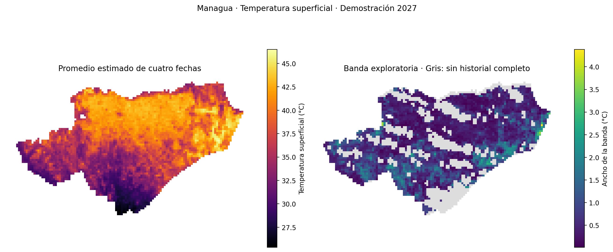

# Surface temperature in Managua

A Python study of land surface temperature at Landsat overpass time. The target is the median surface temperature within each 250 m cell, in °C.

## Retrospective evaluation

The regression models were trained on 12 Landsat scenes from 2023–2025 and evaluated on six scenes from 2026. The table averages each metric across scenes.

| Model | MAE (°C) |
|---|---:|
| Cell historical mean | 3.491 |
| Ridge | **2.245** |
| NGBoost | 3.243 |
| Ridge + ERA5-Land air temperature | 2.280 |
| Ridge + ERA5-Land solar radiation | 2.347 |

Ridge uses prior cell temperature history, day of year, tree cover, built-up fraction, and elevation. Training rows use only earlier dates for their temperature history. NGBoost's nominal 90% prediction intervals covered 40.3% of observations on average across scenes.


## Spatial recurrence

The map shows the average of annual fractions of available scenes in which each cell reached the scene-specific 90th percentile. Cells required valid observations in at least 15 of 18 scenes and representation in all four years. The eligible cells represent approximately 89.9% of municipal land area.


## Reproduce

Run these commands from the repository root in a Python environment:

```bash
python -m pip install -r requirements.txt
python scripts/evaluar_2026.py
python scripts/reentrenar.py
```

The evaluation script uses the included processed panel. The retraining script writes the final Ridge pipeline and cell histories. Run the first cell of `notebooks/02_prueba_modelo_guardado.ipynb` with the working directory set to the repository root for a clean-session prediction demonstration. Retraining before loading the bundled model avoids cross-version joblib compatibility issues. The original research notebook records acquisition and exploratory steps. The committed panel is gzip-compressed; the standalone scripts read it directly. To use the original notebook cells that expect an uncompressed CSV, extract the panel to `data/predictores/managua_panel_con_predictores.csv` first. Some acquisition steps require an authorized Google Earth Engine project.

## Data sources and scope

- [USGS Landsat Collection 2 surface temperature](https://www.usgs.gov/landsat-missions/landsat-collection-2-surface-temperature)
- [ESA WorldCover 2021](https://developers.google.com/earth-engine/datasets/catalog/ESA_WorldCover_v200)
- [Copernicus DEM GLO-30](https://developers.google.com/earth-engine/datasets/catalog/COPERNICUS_DEM_GLO30_2024_1)
- [ERA5-Land hourly](https://developers.google.com/earth-engine/datasets/catalog/ECMWF_ERA5_LAND_HOURLY)
- [geoBoundaries](https://www.geoboundaries.org/)

The final Ridge model was retrained on all 18 scenes from 2023–2026. The 2027 maps are demonstrations. Prospective evaluation requires predictions archived before confirmed Landsat acquisitions and paired observations on the same cells and dates. The multi-date band is exploratory and has no nominal coverage.



## Heat ranking update

The historical recurrence ranking and the XGBoost challenger prioritize 250 m
cells for the observed hottest decile in each Landsat scene. The expanded review
budget is the top 20% of ranked cells.

[Ranking results and reproduction instructions](ranking/README.md) ·
[Download the reproducible package](ranking/managua_actualizacion_reproducible.zip)

The first prospective evaluation used the rankings archived before the
November 25, 2026 Landsat 9 overpass. At the 20% review budget, historical
recurrence recovered 383 of 422 observed hot cells (90.76%) and XGBoost
recovered 359 (85.07%).

[Prospective results, map, and cell-level data](ranking/README.md#evaluación-prospectiva)
