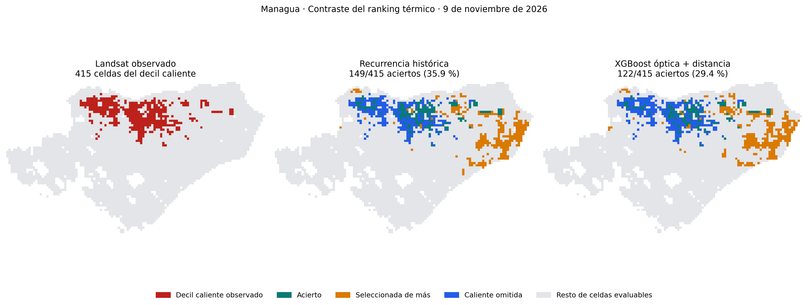
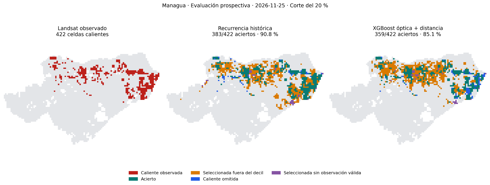

# Ranking de calor superficial en Managua

Esta actualización prioriza celdas de 250 m para localizar el decil más
caliente observado por Landsat. La recurrencia histórica es el ranking
principal y XGBoost con NDVI, NDMI y distancia al Xolotlán es la alternativa.

## Contraste retrospectivo

El ajuste usa 52 escenas anteriores al 9 de noviembre de 2026. En esa fecha
hubo 4,146 celdas evaluables y 415 en el decil caliente.

| Presupuesto | Recurrencia | XGBoost |
|---|---:|---:|
| 10 % | 149/415 | 122/415 |
| 20 % | 304/415 | 299/415 |
| 30 % | 398/415 | 401/415 |

El corte operativo ampliado es el 20 %. En las ocho escenas del bloque
posterior, la recuperación media al 20 % fue 90.55 % para la recurrencia
y 87.21 % para XGBoost. El contraste de noviembre muestra la variación
entre escenas.




## Reproducción desde los CSV

Descargá y extraé el [paquete reproducible](managua_actualizacion_reproducible.zip).
Desde la carpeta extraída, con Python 3.12 en un entorno separado:

```sh
python -m pip install -r requirements-ranking.txt
python reproducir_contraste.py
```

El script recalcula el historial respetando el orden temporal, reentrena
XGBoost y compara los puntajes con los archivados. El notebook principal
conserva el flujo de adquisición y experimentación.

## Evaluación prospectiva

La emisión se archivó el 24 de noviembre de 2026 a las 16:02, hora de
Managua. Landsat 9 adquirió la escena el 25 de noviembre a las 10:06.
Las dos listas permanecieron fijas. Hubo 4,212 celdas con temperatura
válida y 422 en el decil caliente observado.

| Lista archivada | Recurrencia histórica | XGBoost |
|---|---:|---:|
| 10 % · 454 celdas | 285/422 (67.54 %) | 243/422 (57.58 %) |
| 20 % · 908 celdas | 383/422 (90.76 %) | 359/422 (85.07 %) |

Al 20 %, quedaron sin observación válida 32 celdas de recurrencia y 26
de XGBoost. Entre las seleccionadas observables, la precisión fue 43.72 %
y 40.70 %, respectivamente. La comparación corresponde a un sobrevuelo.



- [Métricas al 10 % y 20 %](prospectiva/2026-11-25/metricas_10_y_20.csv)
- [Contraste por celda](prospectiva/2026-11-25/contraste_por_celda.csv)
- [Metadatos de adquisición y emisión](prospectiva/2026-11-25/metadatos_evaluacion.json)
