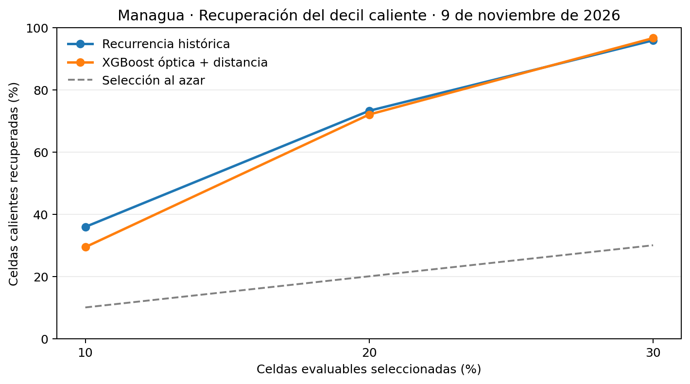

# Ranking de calor superficial en Managua

Esta actualización prioriza celdas de 250 m para localizar el decil más
caliente observado por Landsat. La recurrencia histórica es el ranking
principal y XGBoost con NDVI, NDMI y distancia al Xolotlán es la alternativa.

## Contraste retrospectivo

El ajuste usa 52 escenas anteriores al 9 de noviembre de 2026. En esa fecha
hubo 4,146 celdas evaluables y 415 en el decil caliente.

| Presupuesto | Recurrencia | XGBoost |
|---|---:|---:|
| 10 % | 149/415 | 122/415 |
| 20 % | 304/415 | 299/415 |
| 30 % | 398/415 | 401/415 |

El corte operativo ampliado es el 20 %. En las ocho escenas del bloque
posterior, la recuperación media al 20 % fue 90.55 % para la recurrencia
y 87.21 % para XGBoost. El contraste de noviembre muestra la variación
entre escenas.




## Reproducción desde los CSV

Descargá y extraé el [paquete reproducible](managua_actualizacion_reproducible.zip).
Desde la carpeta extraída, con Python 3.12 en un entorno separado:

```sh
python -m pip install -r requirements-ranking.txt
python reproducir_contraste.py
```

El script recalcula el historial respetando el orden temporal, reentrena
XGBoost y compara los puntajes con los archivados. El notebook principal
conserva el flujo de adquisición y experimentación.

## Evaluación prospectiva

La emisión del 24 de noviembre a las 16:02, hora de Managua, guarda los
rankings para el sobrevuelo esperado del 25 de noviembre. Contiene 4,536
celdas, con 454 en prioridad inicial y 908 en revisión ampliada. La
evaluación queda pendiente de la escena térmica.

Para evaluarla, abrí `evaluacion_prospectiva.ipynb` en el entorno
geoespacial con Earth Engine autenticado. El notebook cruza las listas
archivadas con la escena observada y reporta las celdas seleccionadas
que quedaron sin temperatura válida.
